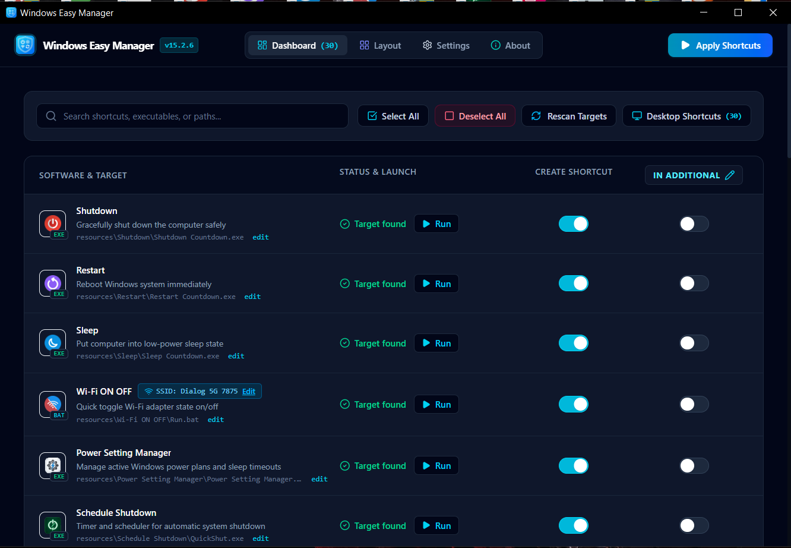
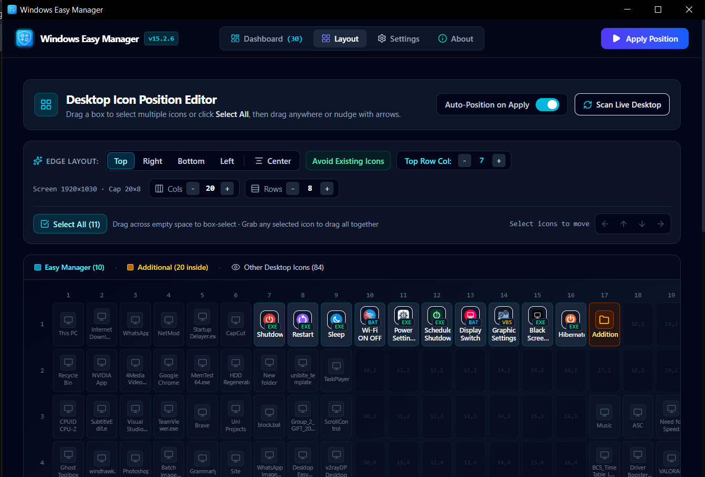
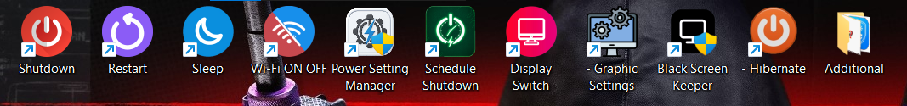
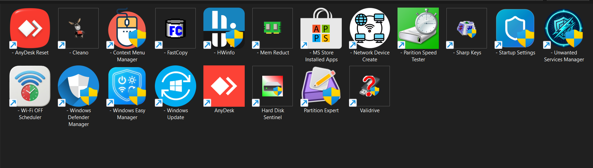
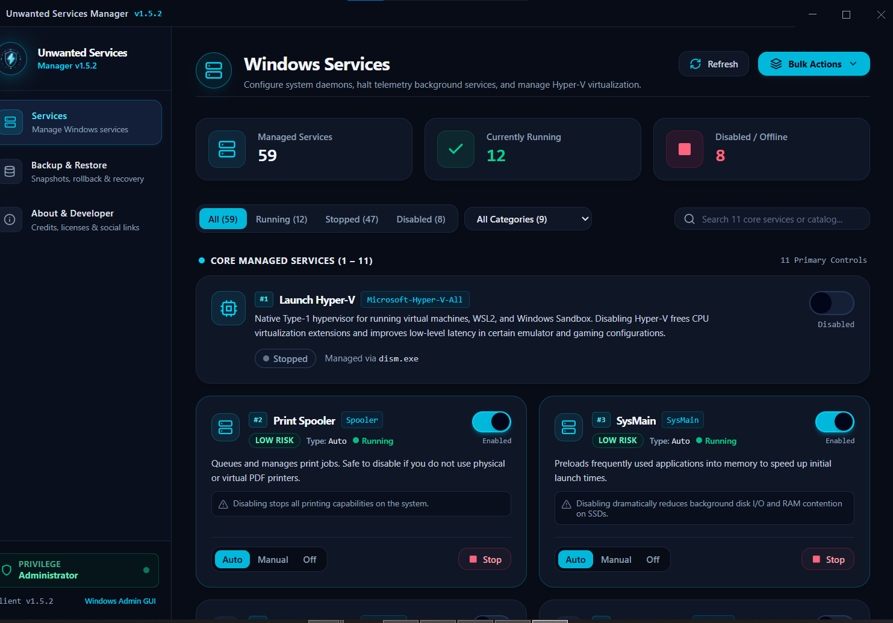
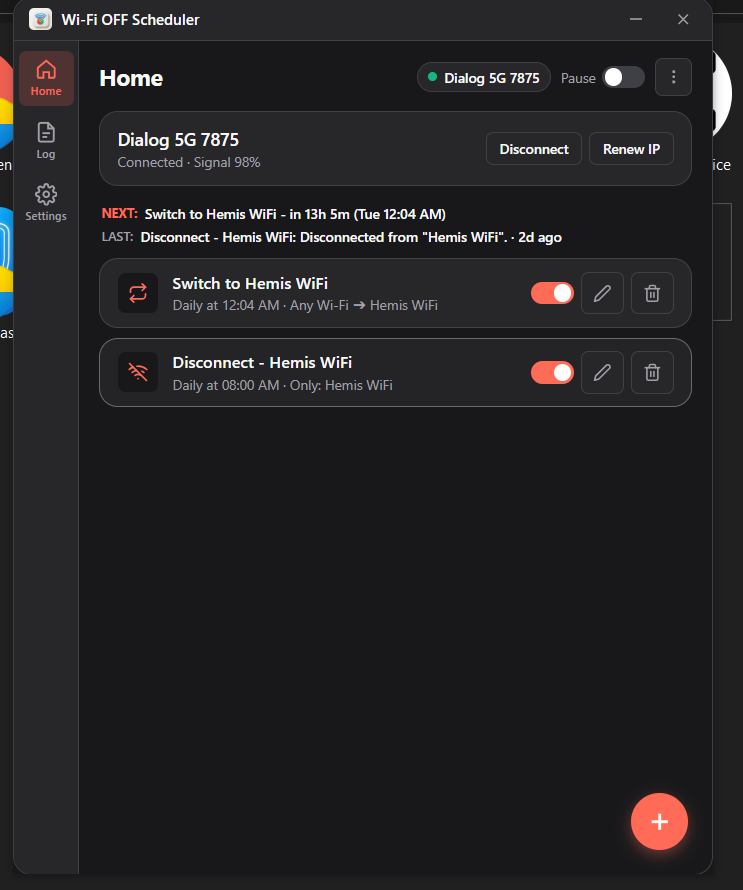
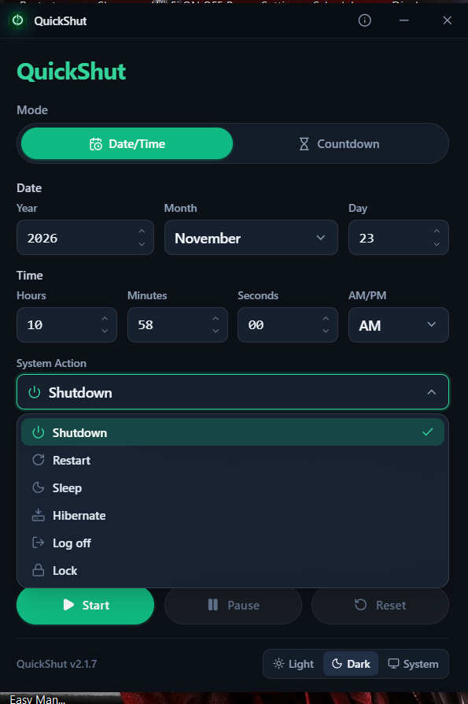
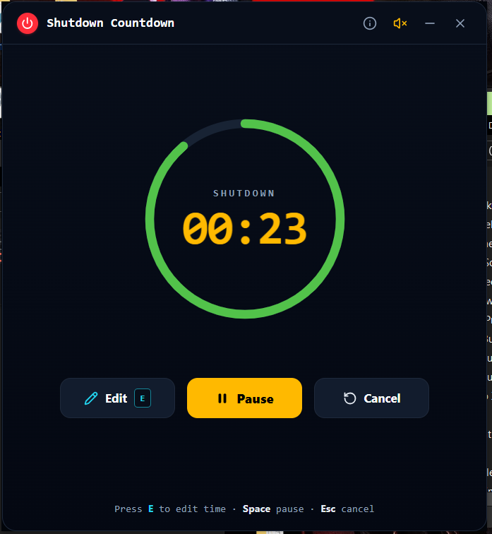

# 🖥️ Windows Easy Manager (`v15.2.6`)

A centralized Windows desktop utility to manage custom system tools, scripts, shortcuts, and desktop icon layouts from one clean interface.

---

## ✨ Key Features

- 📋 **Centralized Dashboard (30 Tools):** Launch, search, and manage `.exe`, `.bat`, and `.vbs` utilities in one place.
- ⚡ **One-Click Shortcut Control:** Toggle **Create Shortcut** or group items inside an **Additional** folder and apply changes with **Apply Shortcuts**.
- 📐 **Visual Desktop Layout Editor:** Arrange desktop icons on a custom column/row grid (e.g., `20×8` on `1920×1080`) with drag, box-select, and arrow-key nudging.
- 🔍 **Live Desktop Sync:** Scan your current desktop layout (**Scan Live Desktop**), avoid overlapping existing icons, and reserve the taskbar area.
- 📁 **Additional Folder Manager:** Set exact grid coordinates (`Col`, `Row`) for the **Additional** folder, highlight items on the grid, or move shortcuts directly to the desktop.

---

## 📸 Screenshots

| Preview | Feature / Tool | What It Shows |
| :---: | :--- | :--- |
|  | **📋 Dashboard & Shortcuts** | Centralized list of 30 tools, `EXE`/`BAT`/`VBS` badges, **Run** buttons, and shortcut/folder toggles |
|  | **📐 Desktop Layout Grid** | Visual column/row icon editor with edge alignment, multi-select, and **Additional** folder coordinates |
|  | **🖥️ Desktop Row Strip** | Desktop icon row arrangement on the Windows desktop |
|  | **📁 Additional Folder Icons** | Tools and utilities grouped inside the **Additional** folder |
|  | **🧹 Services & System Tweaks** | Service controls, startup states, rollback snapshots, and system configuration tools |
|  | **🕒 Wi-Fi OFF Scheduler** | Scheduled Wi-Fi switch/disconnect rules, live status, **Renew IP**, and activity logs |
|  | **⏱️ QuickShut Scheduler** | Schedule **Shutdown, Restart, Sleep, Hibernate, Log off, or Lock** by **Date/Time** or **Countdown** |
|  | **⏳ Shutdown Countdown** | Live visual countdown timer with **Edit**, **Pause**, and **Cancel** controls |

---

## 🛠️ Included Utilities

### 🖥️ Desktop Shortcuts (Primary)
- ⏻ **Shutdown / Restart / Sleep / Hibernate:** Quick system power actions with countdowns.
- 📶 **Wi-Fi ON OFF:** Quick Wi-Fi adapter toggle with editable SSID configuration.
- ⚡ **Power Setting Manager:** Configure Plugged In (AC) & On Battery timeouts (Display, Sleep, Hibernate, HDD), toggle **Never Mode**, and manage **Buttons & Lid**, **Presets**, and **Power Plans**.
- ⏱️ **Schedule Shutdown (`QuickShut v2.1.7`):** Schedule **Shutdown, Restart, Sleep, Hibernate, Log off, or Lock** using **Date/Time** or **Countdown** modes.
- 🖥️ **Display Switch:** Quickly switch projection modes (Duplicate, Extend, Second screen).
- 🎨 **Graphic Settings:** Open Windows graphics performance preferences.
- 🖤 **Black Screen Keeper:** Prevent screen blanking during active tasks.

### 📁 Additional Folder Tools (20 Items)
- 🕒 **Wi-Fi OFF Scheduler:** Automate daily Wi-Fi actions (**Switch Wi-Fi** between networks, **Disconnect Wi-Fi** on schedule), manually **Disconnect** or **Renew IP**, and view execution logs.
- 🧹 **Unwanted Services Manager (`v1.5.2`):** Admin GUI to manage 59 Windows services & daemons, toggle **Hyper-V**, set startup types (`Auto`, `Manual`, `Off`), halt telemetry, and create rollback snapshots.
- 🔄 **Windows Update:** Manage Windows Update service state and pause toggles.
- 🛍️ **MS Store Installed Apps:** Quick access to view and manage installed Store apps.
- 🚀 **Startup Settings (`Startup Settings Manager v5.1.9`):** Full Windows Usability Suite with one-click presets (**Recommended**, **Windows Stock Defaults**, **Gaming & High Performance**), File Explorer/Privacy/Taskbar/UI/Keyboard tweaks, and **Backup & Restore**.
- 🛡️ **Windows Defender Manager:** Manage real-time protection and firewall settings.
- 🖧 **Network Device Create:** Create and configure virtual network adapters.
- 🔄 **AnyDesk Reset:** Reset AnyDesk local configuration and generate a fresh client ID.
- 🐇 **Cleano:** Clean temporary junk, cache files, and system trash.
- 🧠 **Mem Reduct:** Lightweight real-time memory cleaner and cache flush.
- ⌨️ **Sharp Keys:** Remap keyboard keys via the Windows Registry.
- 📋 **Context Menu Manager:** Customize right-click context menu entries and shell extensions.
- 📊 **Partition Speed Tester:** Benchmark sequential and random drive read/write speeds.
- 🔬 **HWiNFO:** Hardware diagnostics, system info, and sensor monitoring.
- ⚡ **FastCopy:** High-speed file copying, syncing, and differential backup.
- 🔗 **AnyDesk:** Fast remote desktop software for remote support and connectivity.
- 💽 **Hard Disk Sentinel:** HDD/SSD health, temperature, and S.M.A.R.T. monitoring.
- 🗂️ **Partition Expert:** Resize, format, convert, and repair disk partitions.
- ❓ **Validrive:** Test USB flash drives and SD cards for fake storage capacity.
- 🖥️ **Windows Easy Manager:** Quick launcher shortcut for Windows Easy Manager itself.

---

## 🚀 Quick Start

1. Keep the executable and the `resources/` folder in the same directory structure.
2. Open **Windows Easy Manager** and check **Dashboard** to confirm every tool shows **Target found**.
3. Toggle **Create Shortcut** and **In Additional** as needed, then click **Apply Shortcuts**.
4. Switch to **Layout**, arrange your icon positions on the grid, and click **Apply Position**.